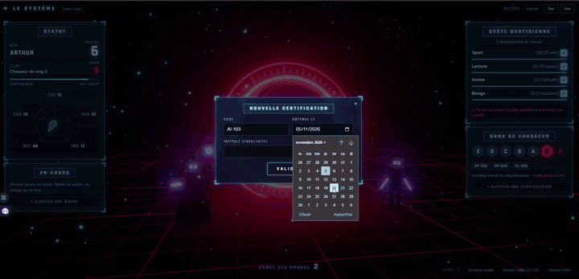
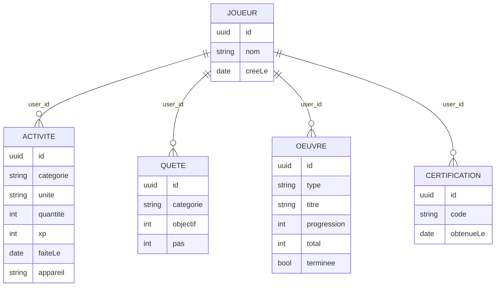
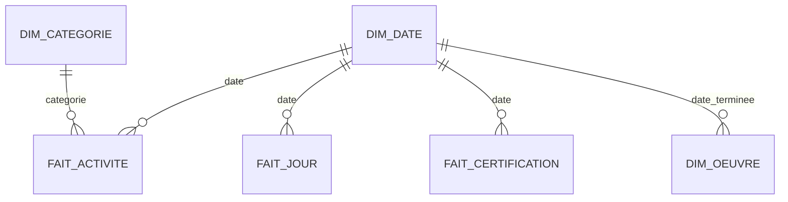

<div align="center">

# ◆ Le Système

**Une application de progression personnelle construite comme une Microsoft Fabric App,<br/>de la saisie opérationnelle jusqu'au rapport Power BI.**


[Démo vidéo](#démo) · [Architecture](#architecture) · [Modèle de données](#modèle-de-données) · [Démarrage](#démarrage) · [CI/CD](#cicd)

</div>

---

## Présentation

**Le Système** transforme les activités du quotidien (sport, lecture, anime, manga, certifications) en une progression de type jeu de rôle :
niveau, expérience, caractéristiques et rang. L'interface reprend l'esthétique des « fenêtres de Système » des récits de chasseurs,
avec une scène 3D temps réel et des cinématiques.

Le projet sert surtout de démonstrateur de bout en bout sur **Microsoft Fabric**. Les mêmes données passent par trois usages :

1. **Opérationnel** : une Fabric App (Rayfin) écrit dans une base SQL Fabric, avec authentification Entra ID et sécurité au niveau des lignes.
2. **Ingénierie de données** : la base est copiée automatiquement dans OneLake, puis un notebook PySpark construit une architecture médaillon.
3. **Analytique** : un modèle sémantique **Direct Lake** et un rapport Power BI lisent la couche gold, sans import ni copie.

Projet réalisé dans le cadre du **#FabricAppsChallenge** (novembre 2026).

## Démo



*Une certification saisie dans l'app : le journal est recalculé, le Système annonce le passage de niveau et la scène change de couleur.*

La démonstration complète (3 min 42, avec le son) est publiée sur LinkedIn pour le #FabricAppsChallenge.

## Fonctionnalités

| Domaine | Description |
|---|---|
| **Quête quotidienne** | Objectifs du jour (sport, pages, épisodes, chapitres). Leur réalisation déclenche un bonus et alimente une série. |
| **Statut du joueur** | Niveau, expérience et cinq caractéristiques recalculés à partir du journal d'activités. |
| **Armée des ombres** | Chaque œuvre terminée génère une unité 3D dont la classe dépend du type d'œuvre (anime, manga, livre). |
| **Rangs** | De E à A selon le nombre de certifications, puis S (DP-600) et Monarque (AI-103). |
| **Terminal mobile** | Version téléphone ouverte par QR code. Les saisies sont rejouées en direct sur l'écran principal. |
| **Journal** | Correction ou suppression d'une saisie, avec recalcul complet des gains associés. |
| **Expérience** | Scène Three.js (bloom, particules, animations), sons synthétisés (Web Audio) et voix du Système (Web Speech). |
| **Analyse** | Rapport Power BI sur deux pages : progression et activités. |

## Architecture

```mermaid
flowchart LR
    subgraph OPS["Opérationnel · Fabric App"]
        direction TB
        UI["Interface React + Three.js<br/>écran principal et terminal mobile"]
        API["API GraphQL Rayfin<br/>Entra ID · sécurité par ligne"]
        DB[("SQL Database in Fabric")]
        UI --> API --> DB
    end

    subgraph DE["Ingénierie de données · OneLake"]
        direction TB
        BR[("Bronze<br/>copie automatique de la base")]
        NB["Notebook PySpark<br/>Pipeline_Medaillon"]
        SI[("Silver<br/>données nettoyées")]
        GO[("Gold<br/>modèle en étoile")]
        BR --> NB --> SI --> GO
    end

    subgraph BI["Analytique · Power BI"]
        direction TB
        SM["Modèle sémantique<br/>Direct Lake"]
        RP["Rapport<br/>Analyse du Joueur"]
        SM --> RP
    end

    DB -. "réplication OneLake" .-> BR
    GO -- "Direct Lake" --> SM
```



### Choix de conception

- **Le journal comme source de vérité.** Chaque action est un événement ajouté à un journal. Niveau, caractéristiques, rang et titre en sont dérivés, jamais stockés. La logique est unique et testée (`app/src/systeme/regles.ts`), et la couche gold applique les mêmes barèmes.
- **Une seule source pour l'opérationnel et l'analytique.** La base SQL Fabric est répliquée nativement dans OneLake. La chaîne analytique la lit sur place, sans pipeline de copie.
- **Sécurité par conception.** Chaque table porte une politique de ligne (`claims.sub = user_id`). La couche silver ne conserve aucun identifiant de compte.
- **Synchronisation multi-appareils.** Chaque saisie porte l'appareil qui l'a faite. L'écran principal rejoue les événements venus d'un autre appareil sous forme de notifications et de cinématiques.
- **Tout est versionné en texte.** Notebook (`.py`), modèle sémantique (TMDL) et rapport (PBIR) sont déployés par la CLI Fabric à partir de ce dépôt, et redéployés automatiquement par GitHub Actions à chaque poussée sur `main` (voir [CI/CD](#cicd)).

## Modèle de données

### Base opérationnelle (SQL Database in Fabric)



### Couche gold (modèle en étoile, Direct Lake)



| Table | Grain | Contenu |
|---|---|---|
| `dim_date` | jour | calendrier en français (mois, semaine ISO, jour de la semaine) |
| `dim_categorie` | catégorie | libellé, caractéristique associée, unité |
| `dim_oeuvre` | œuvre | type, format, avancement, statut, classe d'ombre |
| `fait_activite` | action | XP, minutes, pages, épisodes, chapitres |
| `fait_jour` | jour | XP du jour, XP cumulée, niveau, série de quêtes |
| `fait_certification` | certification | code, date d'obtention |

Mesures principales : *Niveau actuel, Rang, XP total, XP cumulé, XP 7 derniers jours, Série actuelle, Meilleure série, Jours actifs,
Taux de quête, Heures de sport, Pages lues, Épisodes vus, Chapitres lus, Œuvres terminées, Certifications.*

## Stack technique

| Couche | Technologies |
|---|---|
| Application | React 19, TypeScript, Vite, Three.js (post-traitement bloom), Web Audio, Web Speech |
| Backend | Microsoft Fabric Apps (Rayfin SDK), GraphQL, Microsoft Entra ID |
| Données | SQL Database in Fabric, OneLake, Delta Lake, Lakehouse avec schémas |
| Traitement | Notebook PySpark (Fabric Spark) |
| Restitution | Modèle sémantique Direct Lake (TMDL), rapport Power BI (PBIR) |
| Outillage | Rayfin CLI, Fabric CLI, GitHub Actions (OIDC), Vitest, ESLint |

## Démarrage

### Prérequis

- Node.js 20 ou plus récent
- Pour le déploiement : une capacité Microsoft Fabric (F SKU ou essai), le paramètre de locataire « Fabric apps (preview) » activé, et un espace de travail avec les droits Contributeur
- Pour la chaîne analytique : Python 3.10 ou plus récent et la [CLI Fabric](https://aka.ms/fabric-cli)

### En local, sans Fabric

Les données sont conservées dans le navigateur.

```bash
cd app
npm install
npm run dev:horsligne
```

### Déploiement sur Microsoft Fabric

```bash
cd app
npx rayfin login
npx rayfin up --workspace "<espace de travail>"
npx rayfin up status
```

La commande crée la Fabric App, provisionne la base SQL, applique le schéma et publie l'interface.

### Chaîne analytique

Création du lakehouse, import du notebook, du modèle sémantique et du rapport : voir [`analyse/README.md`](analyse/README.md).

### Tests

```bash
cd app
npm test
```

Les tests couvrent les barèmes, les rangs, les quêtes et les bonus, les actions du joueur et la suppression avec recalcul.

## CI/CD

La chaîne analytique se déploie toute seule. Le flux GitHub Actions [`deploy-fabric.yml`](.github/workflows/deploy-fabric.yml)
tourne à chaque pull request et à chaque poussée sur `main` qui touche `analyse/`. Il peut aussi être lancé à la main.

### Ce que fait le flux

| Étape | Pull request | Poussée sur `main` |
|---|:---:|:---:|
| Compilation des scripts Python (notebook, `generer_rapport.py`, `verifier.py`) | ✔ | ✔ |
| Validité JSON de toutes les définitions (`.platform`, `.pbir`, `.pbism`, pages et visuels PBIR) | ✔ | ✔ |
| Régénération du rapport PBIR et comparaison avec le dossier versionné : le script et le dépôt doivent dire la même chose | ✔ | ✔ |
| `fab import` du notebook, du modèle sémantique puis du rapport dans l'espace « Le Système » | | ✔ |

Le déploiement reprend exactement les commandes de [`analyse/README.md`](analyse/README.md), avec la même CLI Fabric
(`ms-fabric-cli`, version figée dans le flux) : ce qui marche à la main depuis le poste marche dans le flux, et inversement.
Le déploiement ne part jamais d'une pull request ni d'une bifurcation. Seul `main` écrit dans Fabric.

### Comment il s'authentifie

Aucun secret, ni dans le dépôt ni dans GitHub. Le flux demande à GitHub un jeton OIDC (permission `id-token: write`),
vérifie qu'Entra ID l'accepte, puis la CLI Fabric l'échange contre un jeton Entra ID avec
`fab auth login -u <id d'application> --federated-token <jeton> --tenant <id du locataire>`. Côté tenant, la mise en place se fait une fois :

1. **Une inscription d'application Entra ID** (ici « GitHub Actions - Le Système »), sans secret ni certificat, avec un
   identifiant fédéré : émetteur `https://token.actions.githubusercontent.com`, audience `api://AzureADTokenExchange`, et pour
   sujet celui que GitHub met dans le jeton de la branche `main`. GitHub y inclut les identifiants numériques du propriétaire
   et du dépôt : `repo:nguekeuarthur@88515280/le-systeme@1439791430:ref:refs/heads/main`
   (`gh api repos/nguekeuarthur/le-systeme --jq '{id, owner_id: .owner.id}'` les donne). Si le sujet ne correspond pas,
   le flux s'arrête avec l'erreur AADSTS700213 d'Entra ID, qui affiche le sujet présenté.
2. **Le paramètre de locataire Fabric** « Les principaux de service peuvent utiliser les API Fabric » activé
   (portail d'administration → Paramètres du locataire → Paramètres du développeur).
3. **Le rôle Contributeur** du principal de service sur l'espace de travail « Le Système » :
   `fab acl set "Le Système.Workspace" -I <id d'objet du principal> -R Contributor`.
4. **Deux variables de dépôt GitHub** (Settings → Secrets and variables → Actions → Variables) :
   `FABRIC_CLIENT_ID` (identifiant d'application) et `FABRIC_TENANT_ID` (identifiant du locataire). Ce ne sont pas des secrets.
   Sans `FABRIC_CLIENT_ID`, le déploiement est sauté et seule la vérification tourne (cas d'une bifurcation non configurée).

Pour utiliser un secret client à la place (autre hébergeur de CI, par exemple), remplace l'étape « Jeton d'identité fédérée »
par `fab auth login -u <id d'application> -p <secret> --tenant <id du locataire>`, le secret étant lu depuis un secret GitHub.
Le reste du flux ne change pas.

### Comment le relancer

- Onglet **Actions** du dépôt → *Déploiement Fabric* → *Run workflow* sur `main` : vérification puis déploiement, sans nouveau commit.
- En ligne de commande : `gh workflow run deploy-fabric.yml`, puis `gh run watch`.
- Une poussée sur `main` qui modifie `analyse/` ou le flux lui-même relance tout. Un changement ailleurs (README, `app/`) ne déclenche rien.
- Si la vérification échoue sur le rapport : `python analyse/generer_rapport.py <id du modèle>` en local, puis versionner le dossier régénéré.

### Pourquoi l'app n'y est pas

L'app Rayfin (`app/`) se déploie avec `npx rayfin up`, après `npx rayfin login`, une connexion interactive dans le navigateur.
La CLI Rayfin accepte bien un principal de service (`rayfin login --service-principal`), mais seulement avec un secret client :
pas d'identité fédérée, donc pas de déploiement sans secret comme pour la chaîne analytique. Et `rayfin up` ne se contente pas
de publier l'interface : il applique aussi le schéma de la base SQL, avec un risque de perte de données sur un changement
destructif (`--force`). L'app reste donc déployée à la main depuis le poste, après relecture du plan (`npx rayfin up -n`).

## Structure du dépôt

```text
.
├── .github/workflows/
│   └── deploy-fabric.yml             vérification et déploiement continu de analyse/
├── app/                              Fabric App
│   ├── rayfin/data/                  entités (tables SQL, permissions par ligne)
│   └── src/
│       ├── systeme/                  règles du jeu, accès aux données, scène 3D, audio
│       ├── components/systeme/       fenêtres, formulaires, terminal mobile, journal
│       └── pages/                    page principale
├── analyse/
│   ├── Pipeline_Medaillon.Notebook/  bronze → silver → gold
│   ├── Analyse_Joueur.SemanticModel/ modèle Direct Lake (TMDL)
│   ├── Analyse_Joueur.Report/        rapport Power BI (PBIR)
│   └── generer_rapport.py            génération du rapport
├── prototype/                        prototype visuel initial
└── fab.ps1                           exécution de la CLI Fabric sur le tenant du projet
```

## Auteur

**Arthur Nguekeu**

| Certification | Intitulé |
|---|---|
| **DP-600** | Microsoft Certified: Fabric Analytics Engineer Associate |
| **DP-700** | Microsoft Certified: Fabric Data Engineer Associate |
| **PL-300** | Microsoft Certified: Power BI Data Analyst Associate |
| **AZ-305** | Microsoft Certified: Azure Solutions Architect Expert |
| **AZ-104** | Microsoft Certified: Azure Administrator Associate |
| **AZ-900** | Microsoft Certified: Azure Fundamentals |
| **AI-900** | Microsoft Certified: Azure AI Fundamentals |
| **SFPC** | Scrum Foundation Professional Certificate |

---

<sub>Projet personnel. L'esthétique s'inspire des récits de chasseurs à « Système ». Tous les visuels sont générés par le code, sans image ni marque d'une œuvre existante. Les identifiants d'espace de travail présents dans <code>analyse/</code> désignent un tenant de démonstration et sont à adapter.</sub>
